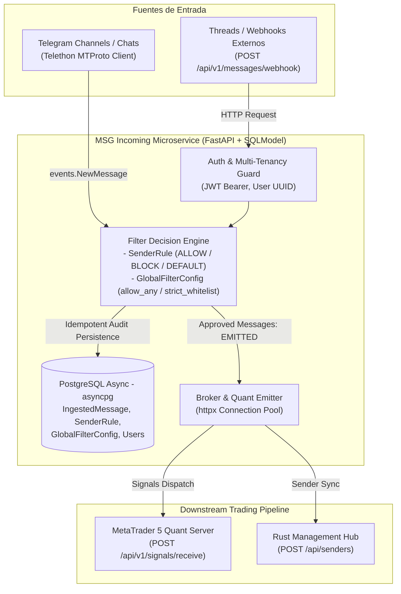

# MSG Incoming - Selective Messaging Ingestor & Router

Microservicio asíncrono de alto rendimiento desarrollado en **Python 3.12**, **FastAPI**, **Telethon (MTProto)** y **SQLModel**, diseñado para la ingesta, filtrado selectivo por emisor, persistencia transaccional idempotente y despacho automático de mensajes y señales hacia motores de trading algorítmico (**MetaTrader 5** y opciones binarias).

---

## 🏛️ Arquitectura del Sistema



---

## 🌟 Características Principales

1. **Selección y Filtrado por Emisor Puro**:
   - En lugar de clasificación semántica, clasifica y enruta según el canal, chat o usuario emisor.
   - **Lista Blanca Prioritaria (`ALLOW`)**: Emisores prioritarios se persisten como `EMITTED` y se despachan al pipeline de trading (`forward_to_brokers=True`).
   - **Lista Negra Explícita (`BLOCK`)**: Emisores bloqueados se auditan como `BLOCKED` con motivo `BLACKLISTED_SENDER` y no se emiten.
   - **Configuración Global Dinámica**:
     - `allow_any_sender=True`: Escucha y procesa cualquier emisor que no esté en la lista negra.
     - `strict_whitelist=True`: Ignora todo emisor que no cuente con una regla explícita en `ALLOW`.
     - Actualización dinámica en caliente mediante API REST (`PUT /api/v1/rules/config`) sin necesidad de reiniciar el servicio.

2. **Cliente MTProto Nativo con Telethon**:
   - Conexión directa mediante **Telethon** integrada en el ciclo de vida `lifespan` de FastAPI.
   - Credenciales seguras mediante variables de entorno: `API_ID` y `API_HASH` (o `TELEGRAM_API_ID` / `TELEGRAM_API_HASH`).
   - Soporte para sesiones persistentes en volumen montado (`.session`) y `StringSession` para entornos efímeros/cloud.
   - Extracción segura de metadatos: `chat_id`, `sender_id`, `username`, `channel_title`, `views`, `forwards`, `raw_text`.

3. **Aislamiento Multiusuario y Tenancy Estricto**:
   - Cada operador dispone de un `user_id: UUID` propio indexado con borrado en cascada (`ondelete="CASCADE"`).
   - **Restricciones de Unicidad Compuestas**:
     - `UniqueConstraint("user_id", "platform", "entity_id")` en reglas de emisor.
     - `UniqueConstraint("user_id", "platform", "external_message_id")` en mensajes auditados.
   - Dos operadores pueden monitorear el mismo canal de Telegram con políticas opuestas (ej. Usuario A en `ALLOW` y Usuario B en `BLOCK`) de manera 100% aislada.

4. **Patrón Funcional Result / Either**:
   - Manejo seguro de errores inspirado en Rust (`Result[T, E]`, `Ok(value)`, `Err(error)`) para eliminar excepciones no controladas y garantizar trazabilidad tipada.

5. **Middleware de Observabilidad**:
   - Generación automática de `X-Correlation-ID` en cada petición.
   - Medición de latencia de procesamiento reportada en el header `X-Process-Time-Ms`.
   - Manejo centralizado de excepciones con respuestas de error estándar en formato JSON.

---

## 📂 Estructura del Proyecto

```text
.
├── Dockerfile                  # Contenedor optimizado Python 3.12 con uv
├── docker-compose.yml          # Orquestación con PostgreSQL 16 y red Docker
├── pyproject.toml              # Dependencias y metadatos del proyecto
├── requirements.txt            # Dependencias fijadas para producción
├── pytest.ini                  # Configuración de pruebas asíncronas
├── .env.example                # Plantilla de variables de entorno
├── alembic.ini                 # Configuración de migraciones
├── migrations/                 # Migraciones de base de datos Alembic
│   ├── env.py
│   ├── script.py.mako
│   └── versions/
│       └── 001_initial_schema.py
├── app/
│   ├── __init__.py
│   ├── main.py                 # FastAPI application factory y ciclo de vida lifespan
│   ├── core/
│   │   ├── config.py           # pydantic-settings con variables de entorno
│   │   ├── database.py         # Motor asyncpg SQLModel y get_session dependency
│   │   ├── middleware.py       # Correlation ID, timing y exception handlers
│   │   ├── result.py           # Mónada Result[T, E] funcional (Ok/Err)
│   │   └── security.py         # Hashing bcrypt, JWT y get_current_user dependency
│   ├── domain/
│   │   ├── enums.py            # PlatformType, SenderPolicy, DeliveryStatus
│   │   ├── models.py           # SQLModel: User, SenderRule, GlobalFilterConfig, IngestedMessage
│   │   └── schemas.py          # Pydantic V2 schemas para requests y responses
│   ├── services/
│   │   ├── filter_engine.py    # Lógica de decisión pura e idempotencia
│   │   ├── telethon_client.py  # Conexión MTProto, listeners y enrutador multiusuario
│   │   └── emitter.py          # Despachador HTTP hacia MetaTrader 5 y Rust hub
│   └── api/
│       └── v1/
│           ├── router.py       # Agregador de rutas API v1
│           └── endpoints/
│               ├── auth.py     # Registro, login JWT (/token) y me
│               ├── rules.py    # CRUD de reglas de emisores y config global
│               └── messages.py # Webhooks y auditoría paginada de mensajes
└── tests/
    ├── conftest.py             # Fixtures async y SQLite in-memory para testing
    ├── test_api_endpoints.py   # Tests de endpoints REST, auth y tenancy
    ├── test_emitter.py         # Tests del despachador downstream a brokers
    ├── test_filter_engine.py   # Tests unitarios del motor de decisión
    └── test_telethon_service.py# Tests del ingestor de eventos Telethon
```

---

## ⚙️ Configuración y Variables de Entorno

Copia el archivo `.env.example` a `.env`:

```bash
cp .env.example .env
```

| Variable | Descripción | Valor por Defecto / Ejemplo |
| :--- | :--- | :--- |
| `API_ID` / `TELEGRAM_API_ID` | Telegram App API ID (my.telegram.org) | `12345678` |
| `API_HASH` / `TELEGRAM_API_HASH`| Telegram App API Hash (my.telegram.org) | `abcdef0123456789...` |
| `TELEGRAM_SESSION_NAME` | Nombre base del archivo `.session` | `msg_ingestor` |
| `TELEGRAM_SESSION_STRING` | StringSession para contenedores sin disco persistente | *(Opcional)* |
| `TELEGRAM_SESSIONS_DIR` | Directorio local/montado para archivos `.session` | `/app/sessions` |
| `POSTGRES_USER` | Usuario de PostgreSQL | `admin` |
| `POSTGRES_PASSWORD` | Contraseña de PostgreSQL | `quant_secure_pwd` |
| `POSTGRES_HOST` | Host del servidor PostgreSQL | `postgres` (en Docker) o `localhost` |
| `POSTGRES_PORT` | Puerto de PostgreSQL | `5432` |
| `POSTGRES_DB` | Base de datos | `msg_incoming_db` |
| `SECRET_KEY` | Clave secreta para tokens JWT | `secret-key-32-chars...` |
| `DEFAULT_ADMIN_EMAIL` | Correo del usuario administrador inicial | `admin@quant.com` |
| `DEFAULT_ADMIN_PASSWORD` | Contraseña del admin inicial | `AdminPasswordSecure2026!` |
| `BROKER_API_URL` | URL de `metatrader5-quant-server-python` | `http://metatrader5-quant-server:8000` |
| `RUST_APP_URL` | URL del servidor web en Rust | `http://rust-app:3000` |

---

## 🚀 Despliegue con Docker Compose

Para iniciar el microservicio junto con su contenedor PostgreSQL independiente:

```bash
docker compose up -d --build
```

El servicio estará disponible en:
- **API Base**: `http://localhost:8001`
- **Documentación Swagger / OpenAPI**: `http://localhost:8001/docs`
- **Healthcheck**: `http://localhost:8001/health`

---

## 🧪 Ejecución de Pruebas Unitarias e Integración

Las pruebas se ejecutan de manera aislada utilizando una base de datos SQLite asíncrona en memoria (`sqlite+aiosqlite:///:memory:`) sin requerir dependencias externas activas:

```bash
# Con el entorno virtual activo:
.venv/bin/pytest tests/ -v
```

Resultado verificado:
```text
tests/test_api_endpoints.py::test_auth_registration_and_login PASSED
tests/test_api_endpoints.py::test_sender_rules_crud PASSED
tests/test_api_endpoints.py::test_global_filter_config_api PASSED
tests/test_api_endpoints.py::test_webhook_message_ingestion_and_history PASSED
tests/test_api_endpoints.py::test_multi_user_api_isolation PASSED
tests/test_emitter.py::test_emitter_extracts_trading_hints PASSED
tests/test_emitter.py::test_emitter_successful_post PASSED
tests/test_emitter.py::test_emitter_handles_network_error PASSED
tests/test_filter_engine.py::test_filter_engine_allow_policy PASSED
tests/test_filter_engine.py::test_filter_engine_block_policy PASSED
tests/test_filter_engine.py::test_filter_engine_strict_whitelist_ignores_unlisted PASSED
tests/test_filter_engine.py::test_filter_engine_allow_any_sender_dynamic PASSED
tests/test_filter_engine.py::test_filter_engine_idempotency_per_user PASSED
tests/test_filter_engine.py::test_multi_user_tenancy_isolation PASSED
tests/test_telethon_service.py::test_telethon_message_event_handling_and_dispatch PASSED

============================== 15 passed in 5.61s ==============================
```

---

## 📡 Referencia de la API REST

### 1. Autenticación (`/api/v1/auth`)
- `POST /api/v1/auth/register`: Registro de nuevo operador.
- `POST /api/v1/auth/token`: Login vía OAuth2 Password Grant para obtener JWT.
- `GET /api/v1/auth/me`: Perfil del usuario autenticado.

### 2. Reglas de Filtrado y Configuración (`/api/v1/rules`)
- `POST /api/v1/rules/senders`: Crear o actualizar regla de un emisor (ALLOW / BLOCK / DEFAULT, `forward_to_brokers`).
- `GET /api/v1/rules/senders`: Listar reglas activas con filtros por plataforma, política y paginación.
- `DELETE /api/v1/rules/senders/{sender_identifier}`: Eliminar regla por ID o ID de entidad.
- `PUT /api/v1/rules/senders/{rule_id}/toggle`: Conmutar estado activo/inactivo (`is_active`).
- `GET /api/v1/rules/config`: Obtener configuración global por plataforma.
- `PUT /api/v1/rules/config`: Modificar en caliente `allow_any_sender` o `strict_whitelist`.

### 3. Ingestión y Auditoría (`/api/v1/messages`)
- `POST /api/v1/messages/webhook`: Ingesta HTTP de mensajes externos (Threads, TradingView, manual).
- `GET /api/v1/messages/history`: Consulta paginada del historial de mensajes auditados, filtros por estado (`EMITTED`, `BLOCKED`, `IGNORED`) y emisor.
- `GET /api/v1/messages/{message_id}`: Consulta detallada de metadatos de un mensaje.
